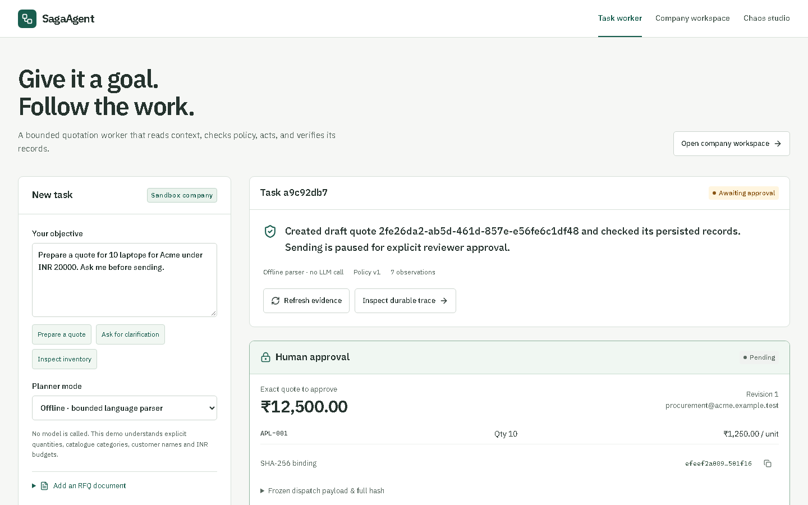
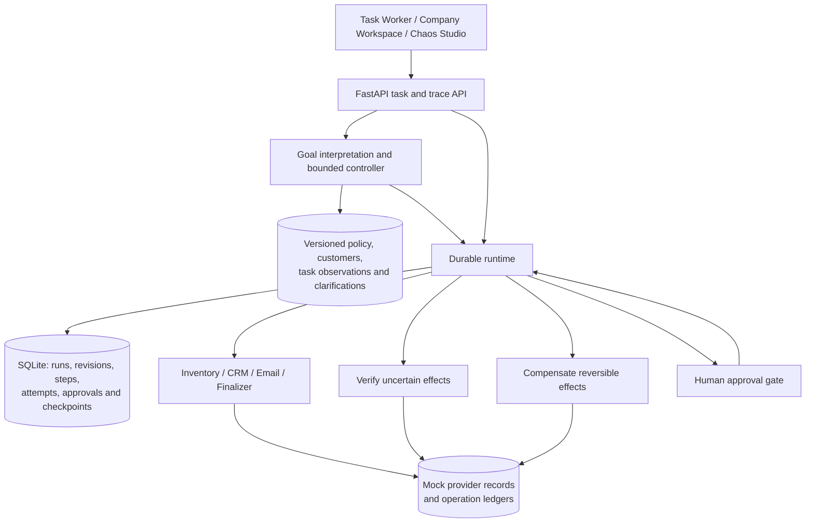
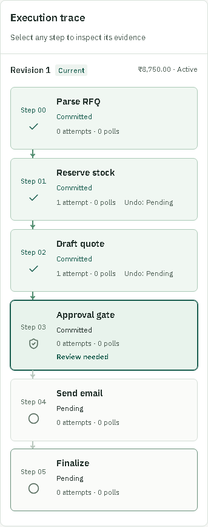

# SagaAgent

**A goal-driven quotation worker with durable execution, verified recovery, and human approval.**

**[Live demo on AWS](https://saga.65.0.103.235.sslip.io)** · Password-protected; [request demo access by email](mailto:sameerprasad2000@gmail.com?subject=SagaAgent%20demo%20access).

The hosted demo uses simulated business providers. Access includes shared task and
chaos controls, so the demo password is shared privately.

[](https://github.com/Stark2028/saga-agent/actions/workflows/ci.yml)


SagaAgent takes a business objective, reads company context, selects approved products, executes a quotation workflow, observes its results, and returns evidence. Its durable runtime handles uncertain API outcomes, worker crashes, compensation, and approvals bound to the exact dispatch payload.

The **Task Worker** accepts a goal and optional text RFQ, asks for clarification when needed, and pauses for review before sending. The **Company Workspace** independently exposes the records it creates. **Trace & Chaos Studio** shows every durable boundary and supports the original five fault scenarios.

> **Implementation scope:** a bounded quotation/inventory worker, SQLite persistence, and database-backed mock business providers. Choose a clearly labeled **offline language parser** or configure **OpenAI structured interpretation**. No API key is needed for offline demos. All business delivery is simulated, including `LIVE` mode. Browser/computer-use automation and production provider integrations are future work.



[Quick start](#quick-start) · [Architecture](#architecture) · [Guided demos](#guided-demos) · [Verification](#verification) · [API](#api) · [Limitations](#limitations-and-roadmap)

## The problem

A timeout does not tell you whether a remote write happened. Retrying can create a duplicate quote or reserve inventory twice. A process can die after an external commit but before recording success. An approval can become stale when the customer changes the order.

SagaAgent makes those boundaries explicit:

| Failure | Runtime behavior |
| --- | --- |
| CRM write succeeds but its response is lost | Persist uncertainty, verify the existing operation, then commit its known outcome. |
| Worker exits with a step in flight | Recover from persisted state after the prior lease expires. |
| Reviewer rejects a draft | Void the quote and release inventory in reverse order. |
| Compensation fails | Halt with the uncompensated resource ID visible for operator attention. |
| RFQ changes after approval | Invalidate the old approval, compensate the previous revision, and require a new decision. |
| Operator replays a historical checkpoint | Fork into an isolated sandbox with remapped operation IDs and fresh approval. |

## Features

- **Goal-driven intake:** natural-language quotation/inventory requests, optional text RFQ upload, configurable OpenAI interpretation and a transparent offline parser.
- **Observe and adapt:** versioned company context, clarification, approved-stock selection, persisted decisions, bounded recovery, and record-backed completion summaries.
- **Durable intent and attempts:** database records precede tool execution; external effects commit separately from runtime bookkeeping.
- **Three-valued verification:** `APPLIED`, `DEFINITIVELY_NOT_APPLIED`, and `UNKNOWN`. An unknown outcome never authorizes a blind retry.
- **Concurrency controls:** persisted leases, optimistic versions, and attempt-generation fencing guard execution and stale writes.
- **Payload-bound approval:** canonical SHA-256 state hashes and HMAC signatures bind reviewer decisions to the exact revision and dispatch payload.
- **Recoverable compensation:** corrective operations have stable IDs, persisted attempts, and verification of their own outcomes.
- **Historical sandbox replay:** immutable `BEFORE_STEP` checkpoints at boundaries 0–3 isolate child records from the parent.
- **Operator studio:** guided faults, connected step traces, evidence inspection, approval/revision controls, external-state tables, and benchmark results.
- **Typed contracts:** 15 FastAPI routes and 38 generated schema components shared with the TypeScript client.

## Architecture



The mock provider records and runtime state share the SQLite database but use **separate commits**. This preserves the failure window between a completed effect and recorded runtime success. A provider ledger fences superseded attempt generations.

Commands execute inline until they reach approval, completion, or a safe halt. Task workers observe uncertain/crashed boundaries and attempt bounded reconciliation automatically; the Chaos Studio also exposes explicit **Resume**. There is no background recovery scheduler. A simulated crash releases its lease for immediate demos; an actual process exit leaves the lease until expiry. The test suite includes a subprocess that exits immediately after an external commit.

Approval does not authorize arbitrary future work. Dispatch consumes the approval atomically and prevents subsequent revision. Email is irreversible; finalization rolls forward and converts reserved inventory into fulfilled stock.

### Stack

| Layer | Technology |
| --- | --- |
| API | Python, FastAPI, Pydantic |
| Persistence | SQLModel, SQLAlchemy async sessions, SQLite, aiosqlite |
| Frontend | React 19, TypeScript, Vite, Tailwind CSS 4, Lucide |
| Tests | pytest, pytest-asyncio, HTTPX, Vitest, Testing Library, Playwright Chromium |
| Goal interpretation | Bounded offline parser or configurable OpenAI Responses API structured output |
| Automation | GitHub Actions; backend checks on Windows and Linux |

## Quick start

**Prerequisites:** Git, Python 3.11+ (3.12 used for verification), and Node.js 22 with npm. Reserve ports **8000** for the API and **3000** for the studio.

```bash
git clone https://github.com/Stark2028/saga-agent.git
cd saga-agent
```

<details open>
<summary><strong>Windows · PowerShell</strong></summary>

Install dependencies from the repository root:

```powershell
python -m venv .venv
.\.venv\Scripts\python.exe -m pip install -r backend/requirements-tested.txt -e './backend[test]'
npm.cmd --prefix frontend ci
```

Start the API in terminal 1:

```powershell
$env:SAGA_HMAC_SECRET = [guid]::NewGuid().ToString() + [guid]::NewGuid().ToString()
$env:SAGA_REVIEWER_TOKENS = '{"local-reviewer-token":"sales_mgr_01"}'
Set-Location backend
..\.venv\Scripts\python.exe -m uvicorn app.main:app --host 127.0.0.1 --port 8000
```

Start the studio in terminal 2, from the repository root:

```powershell
Set-Location frontend
npm.cmd run dev
```

</details>

<details>
<summary><strong>macOS / Linux · Bash</strong></summary>

Install dependencies from the repository root:

```bash
python3 -m venv .venv
.venv/bin/python -m pip install -r backend/requirements-tested.txt -e './backend[test]'
npm --prefix frontend ci
```

Start the API in terminal 1:

```bash
export SAGA_HMAC_SECRET="$(.venv/bin/python -c 'import secrets; print(secrets.token_hex(32))')"
export SAGA_REVIEWER_TOKENS='{"local-reviewer-token":"sales_mgr_01"}'
cd backend
../.venv/bin/python -m uvicorn app.main:app --host 127.0.0.1 --port 8000
```

Start the studio in terminal 2, from the repository root:

```bash
cd frontend
npm run dev
```

</details>

Open **[the task worker](http://127.0.0.1:3000)**, **[company workspace](http://127.0.0.1:3000/company)**, **[Chaos Studio](http://127.0.0.1:3000/studio)** or **[interactive API docs](http://127.0.0.1:8000/docs)**. Startup creates the schema and seeds the 30-item catalogue, two demo customers and versioned policy automatically. Twenty RFQ presets remain available in the Chaos Studio.

Keep the same HMAC secret when restarting against an existing database so recorded approvals remain valid. The default database is `backend/saga.db` when the server starts from `backend/`. Local database files are ignored by Git.

### Configuration

| Variable | Purpose | Default |
| --- | --- | --- |
| `SAGA_HMAC_SECRET` | Approval-signing secret, at least 32 characters | Required |
| `SAGA_REVIEWER_TOKENS` | JSON mapping of bearer token to reviewer identity | `{}` |
| `SAGA_DATABASE_URL` | Async SQLAlchemy database URL | `sqlite+aiosqlite:///./saga.db` |
| `OPENAI_API_KEY` | Backend-only credential for optional OpenAI interpretation | Empty |
| `SAGA_OPENAI_MODEL` | A model you can access supporting Responses structured outputs | Empty |
| `VITE_API_BASE_URL` | Direct API address; empty uses Vite's `/api` proxy | Empty |
| `VITE_REVIEWER_ID` | Local demo reviewer identity | `sales_mgr_01` |
| `VITE_REVIEWER_TOKEN` | Local demo bearer token | `local-reviewer-token` |
| `SAGA_TEST_PYTHON` | Optional Python executable for browser integration tests | Repository `.venv` |

The commands above match the studio's demo reviewer profile. Reviewer credentials are checked on approval and rejection. Frontend `VITE_*` values are public build inputs; the demo token is for this local mock harness. See [frontend/.env.example](frontend/.env.example).

OpenAI mode becomes available when both backend model variables are configured before startup. It sends the submitted goal, source text, clarifications and company context to the model and validates its proposal before execution. Errors/refusals block effects; there is no silent offline fallback. Live model calls require your credentials and have not been verified in the recorded offline run. See [backend/.env.example](backend/.env.example) and the [agent design and setup guide](docs/AGENT_WORKER.md).

The API allows browser requests from `http://localhost:3000` and `http://127.0.0.1:3000`. The Vite development proxy targets `http://127.0.0.1:8000`. A production frontend build needs an API base URL or a reverse proxy serving `/api`.

## Goal-driven task demo

At `/`, execute:

> Prepare a quote for 10 laptops for Acme under INR 20000. Ask me before sending.

Watch the worker load company context, select approved in-stock items, calculate the total, create a draft and verify its records. Approve through the reviewer card to dispatch and finalize, then inspect the company workspace. Try `Prepare a quote for Acme.` to exercise clarification, or `Inspect current inventory availability.` for a read-only task.

Upload a `.txt`/`.md` RFQ to preserve its source hash and read its contents. Recovery demonstration can lose the CRM response or crash after an inventory commit; the worker attempts bounded recovery without allocating another run. Company policy never permits unapproved dispatch or silent substitution of an explicitly requested SKU.

The interpreter proposes intent. Code selects allowed actions and validates prices, budgets and permissions. The controller is deliberately limited to quotation/inventory tasks; it does not claim general computer-use autonomy. See [the full agent workflow](docs/AGENT_WORKER.md).

## Guided demos

At `/studio`, use the five numbered controls. Step selection opens persisted inputs, outputs, verification evidence, compensation evidence, and attempt history.

| Demo | What to do | What to inspect |
| --- | --- | --- |
| **1 · Lost CRM response** | Launch, then **Resume / Reconcile** | Step 2 becomes reconciled; exactly one CRM quote exists. |
| **2 · Worker crash** | Launch; the UI loads the run from its `503` response; **Resume run** | Persisted in-flight intent and recovery evidence. |
| **3 · Rejection & rollback** | **Reject & roll back**; try a new run with **Fail inventory compensation** enabled | Clean rollback versus `FAILED_NEEDS_HUMAN` with its hold ID. |
| **4 · Stale approval** | **Approve & pause**, then **Revise RFQ** | Invalidated old approval, compensated prior revision, and a fresh approval hash. |
| **5 · Sandbox fork** | Select a revision and boundary, then **Fork to sandbox** | Parent provenance, source record map, isolated inventory/quotes, and fresh approval. |

The low-level Chaos Studio RFQ form uses explicit SKU lines such as `10 x APL-001, 2 x APL-002`; its deterministic planner rejects unsupported prose and unknown SKUs. The Task Worker interprets supported business-language requests before constructing that validated RFQ. All monetary values in API payloads are **integer INR paise**; the UI formats them as rupees.

<details>
<summary><strong>Mobile execution trace</strong></summary>

The studio uses a connected vertical timeline on narrow screens, keeps the five demos visible, and collapses the creation form after a run loads.



</details>

## Verification

Recorded local verification:

| Check | Result |
| --- | --- |
| Backend | **89 tests passed**, with warnings treated as errors |
| Frontend component and API-client tests | **8 tests passed** |
| Chromium integration | **24 scenario, interaction and responsive checks passed** |
| TypeScript, ESLint, production build | Passed |
| Generated contracts | **38 schema components verified** |
| Responsive coverage | 320, 375, 768, 1024, and 1440px widths |

The [CI workflow](.github/workflows/ci.yml) reruns backend tests on Windows and Linux and frontend/browser checks on Linux. Published counts describe recorded verification; the CI badge shows the current repository status.

From `backend/` on Windows:

```powershell
..\.venv\Scripts\python.exe -m pytest -q -W error --junitxml=pytest-results.xml
```

On macOS/Linux, use `../.venv/bin/python` in place of the Windows Python path.

From `frontend/`:

```bash
npm run generate:types -- --check
npx tsc --noEmit
npm run lint
npm test
npm run build
npx playwright install chromium
npm run test:integration
```

Use `npm.cmd` and `npx.cmd` if PowerShell's execution policy blocks their `.ps1` launchers. Browser integration starts its own temporary backend and frontend, uses a fresh database, and closes both afterward. Stop a running studio on port 3000 before starting it. Linux environments may need `npx playwright install --with-deps chromium`.

See [frontend/VERIFICATION.md](frontend/VERIFICATION.md) for measured frontend results. Backend tests cover subprocess termination, competing leases, stale owners, uncertain effects, failed compensation, approval/revision races, stock contention, and historical forks.

The separate task evaluation uses isolated databases for 12 cases covering natural-language variations, clarification, budget violations, document intake, approval bypass attempts and fault recovery. Its recorded **offline result is 12/12**; this does not measure a live language model. Run `python -m scripts.run_agent_evals` from `backend/`; the report is [AGENT_EVAL_RESULTS.json](backend/AGENT_EVAL_RESULTS.json). Use `--mode openai` only after configuring the provider, and report those model results separately.

## Benchmark

The benchmark compares SagaAgent with an intentionally naive retry runner on the same seeded RFQs in isolated databases: **100 cases per runner, 200 executions total**, with 20 cases in each cohort.

| Outcome | Direction | SagaAgent | Naive retry |
| --- | --- | ---: | ---: |
| Duplicate CRM quotes | Lower is better | **0/20** | 20/20 |
| Clean recovery without duplicate holds | Higher is better | **20/20** | 0/20 |
| Orphaned inventory holds | Lower is better | **0/20** | 20/20 |
| Failed compensation surfaced with resource ID | Higher is better | **20/20** | 0/20 |
| Stale emails dispatched | Lower is better | **0/20** | 20/20 |

These are deterministic mock results against a deliberately weak baseline, not a comparison with production workflow platforms. The failed-compensation cohort intentionally retains the affected hold and measures accurate escalation.

Reproduce from `backend/`:

```powershell
..\.venv\Scripts\python.exe -m scripts.run_benchmarks --seed 20261026
```

The command writes [BENCHMARK_RESULTS.md](BENCHMARK_RESULTS.md), the [API artifact](backend/BENCHMARK_RESULTS.json), and fresh raw evidence under `backend/.benchmark-runs/<uuid>/`. Raw databases are generated locally and excluded from Git.

## API

| Method | Endpoint | Purpose |
| --- | --- | --- |
| `GET` | `/api/agent/capabilities` | Inspect configured planner modes and permitted tools |
| `GET` | `/api/company` | Read versioned policy, customers, stock, quotes and dispatches |
| `POST` | `/api/tasks` | Interpret and execute a bounded business goal |
| `GET` | `/api/tasks` | List the latest 20 task records |
| `GET` | `/api/tasks/{task_id}` | Read observations, evidence, summary and associated trace |
| `POST` | `/api/tasks/{task_id}/continue` | Clarify or continue a persisted task |
| `POST` | `/api/runs` | Create and execute an RFQ run |
| `GET` | `/api/runs/{run_id}/trace` | Read the complete trace and external state |
| `POST` | `/api/runs/{run_id}/resume` | Recover or continue execution |
| `POST` | `/api/runs/{run_id}/approve` | Approve the bound revision/hash; bearer authentication required |
| `POST` | `/api/runs/{run_id}/reject` | Reject and compensate; bearer authentication required |
| `POST` | `/api/runs/{run_id}/revise-rfq` | Create a new immutable RFQ revision |
| `POST` | `/api/runs/{run_id}/fork` | Replay a historical checkpoint in a sandbox |
| `POST` | `/api/chaos/scenarios/{scenario_id}` | Launch a seeded scenario (`rfq_01`–`rfq_20`) |
| `GET` | `/api/chaos/benchmarks` | Read persisted benchmark measurements |

Successful run commands return `RunTraceResponse`; task commands return `TaskResponse` with `task`, nullable `trace`, `summary` and `checks`. Expected request errors use `{"error":{"code":"...","message":"...","details":[]}}`. A created task blocked by model configuration/provider errors or policy checks is returned with `task.status=BLOCKED` and `task.error_code`. Injected low-level worker crashes return `503` with `details[0].run_id`, allowing the studio to load the durable trace immediately.

The exact contracts are in [OpenAPI](backend/openapi.json), [response schemas](backend/response-schemas.json), and [generated TypeScript](frontend/src/types/saga.ts). A complete [trace example](backend/examples/run-trace.json) is included. After API schema changes, export contracts from `backend/` with `python -m scripts.export_contracts`, then run `npm run generate:types` from `frontend/`.

## Repository layout

```text
backend/
  app/
    agent/          Task controller, interpretation, context and deterministic RFQ planning
    api/            Routes, authentication and response schemas
    db/             Models, async sessions and catalogue seeds
    engine/         Runtime, leases, approvals, compensation and forks
    tools/          Mock provider adapters and fault injection
  scripts/          Seed generation, benchmarks and contract export
  tests/            API, concurrency, recovery and workflow tests
frontend/
  src/
    app/            Task worker, company workspace and operator studio
    components/     Trace, approval, sandbox and resource views
    lib/            Typed client, formatting and execution focus
    types/          Generated OpenAPI TypeScript contracts
    test/           Component and API-client tests
  scripts/          Type generation and browser integration
docs/images/        Studio screenshots
.github/workflows/  Continuous integration
```

See [architecture resolutions](ARCHITECTURE_V2_RESOLUTIONS.md), [design notes](DESIGN.md), and the [bug/limitations log](BUGS.md) for deeper implementation decisions.

## Limitations and roadmap

- **Providers and planning:** mock CRM/inventory/email; a bounded task controller with offline or configured OpenAI interpretation. Live model calls are unverified without credentials. No general browser agent or external business-provider adapter.
- **Recovery:** bounded task-level recovery and explicit resume; no background recovery scheduler or lease heartbeat during long remote calls.
- **Persistence:** SQLite verified locally; PostgreSQL driver support is declared but concurrency behavior is unverified; schema migrations are not implemented.
- **Access control:** configured reviewer token map; no tenant isolation or SSO. Trace, mutation, and chaos routes require additional authorization before public deployment.
- **Operations:** no API command idempotency keys, hold expiry, or guided repair workflow for exhausted effects.
- **Scale:** full checkpoints and unpaginated traces target a bounded demonstration dataset. Real adapters need provider-specific reconciliation and finalization.

The next engineering milestones are live-model evaluation with configured credentials, a real provider or browser tool, background recovery scheduling, API idempotency and PostgreSQL migrations/concurrency tests.

## Author and licensing

Built by **[Sameer Prasad](https://github.com/Stark2028)**.

**All rights reserved.** This repository does not grant an open-source license. See [LICENSE](LICENSE); third-party dependencies retain their own licenses.
