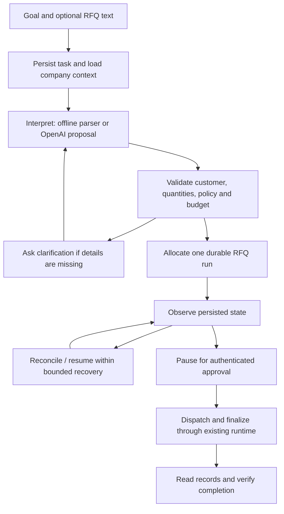

# Goal-driven task worker

SagaAgent now has a bounded task controller above its durable quotation runtime. It accepts a business objective and optional text/Markdown RFQ, reads persisted company context, chooses permitted actions, observes their outcomes, attempts bounded recovery and returns record-backed evidence.

## Try it

Open `/` for the task worker, `/company` for the independent business-record view, or `/studio` for the original trace and chaos workbench.

Example goal:

> Prepare a quote for 10 laptops for Acme under INR 20000. Ask me before sending.

The worker reads the versioned policy and customer directory, selects the cheapest approved in-stock laptop, calculates prices in integer paise, creates a draft through the durable runtime, checks the quote and hold, and pauses for approval. Approve through the existing authenticated reviewer card to dispatch and finalize. The final summary is checked against the CRM record, inventory hold, consumed approval and matching email.

Other demos:

- `Prepare a quote for Acme.` asks for products and quantities. Answer `3 keyboards under INR 10000` to continue the same task.
- `Inspect current inventory availability.` selects the read-only inventory action and creates no run or external effects.
- Upload a text RFQ containing `Customer: Acme. Please quote 2 monitors under INR 5000.` and use `Prepare the requested quote` as the objective.
- Select a lost CRM response or inventory-commit crash in Recovery demonstration. The controller reads the persisted boundary and reconciles the existing operation automatically, within its recovery bound.

## Planner modes

**Offline** is the default and is explicitly labeled as a bounded language parser. It recognizes a limited vocabulary: supported product categories or explicit APL SKUs, quantities (including a small set of number words), known customer names or supplied email addresses, and numeric INR budgets. It is useful for reproducible evaluation. It is not an LLM or a general natural-language agent. Unsupported/missing details ask for clarification.

**OpenAI** interprets the goal/document into a strict `TaskIntent` proposal using the [Responses API's structured output format](https://developers.openai.com/api/docs/guides/structured-outputs). Set both environment variables in the backend terminal before starting or restarting it:

```powershell
$env:OPENAI_API_KEY = '<your API key configured locally>'
$env:SAGA_OPENAI_MODEL = '<a model you can access that supports Responses structured outputs>'
```

Do not put an API key in the frontend or commit it. The application reads process environment variables; `.env` files are not auto-loaded. See `backend/.env.example`. The mode selector becomes available when both values are configured. No particular model or account entitlement is assumed.

The model receives the submitted goal, source text, clarifications and company context. Requests use `store: false`, a 25-second timeout, a bounded output budget and JSON Schema validation. Refusal, incomplete output, provider errors and invalid proposals block execution; the app never silently falls back to offline mode. Live API execution has not been verified without user-provided credentials. Provider request/output handling is covered with stubbed HTTP responses.

## Controller and trust boundaries



The model proposes intent; code controls execution and selects allowed catalogue records. It cannot set prices, invoke arbitrary tools, authorize dispatch or override company policy. Public decision summaries and evidence are persisted; private model reasoning is not requested or stored.

Company memory is stored in versioned `company_memory` records. The seed policy selects the lowest-price in-stock approved category option, forbids silent substitution of explicit SKUs, limits quantity and quote value, and requires human approval. Tasks retain their policy snapshot. Budget and policy context are included in the RFQ state that the existing approval hash binds. Quote revisions and sandbox overrides are checked against the frozen budget.

Task commands acquire a persisted 90-second lease. Each task write verifies ownership and expiry and renews that lease. A task persists its allocated run UUID before starting the runtime; retries reuse that UUID and reject mismatched immutable requests. The runtime retains its separate 30-second lease and attempt-generation fencing. No database migration of existing runtime tables is required: the extension adds two tables.

Automatic recovery is limited to two controller attempts per invocation, each subject to the runtime's own verification and retry bounds. Pending approval and human-escalation states stop the controller. Actual process termination may require explicit task continuation after the relevant leases expire; there is no background scheduler.

## API contracts

| Method | Path | Success response |
| --- | --- | --- |
| GET | `/api/agent/capabilities` | `AgentCapabilities` |
| GET | `/api/company` | `CompanyResponse` |
| POST | `/api/tasks` | `TaskResponse` (201) |
| GET | `/api/tasks` | `TaskRecordResponse[]` (latest 20) |
| GET | `/api/tasks/{task_id}` | `TaskResponse` |
| POST | `/api/tasks/{task_id}/continue` | `TaskResponse` |

`TaskResponse` has exactly `task`, `trace`, `summary`, and `checks`. `trace` is a complete `RunTraceResponse` or null before a run exists. `checks` contains `{name, passed, evidence}`. The task record includes goal, source name/hash, planner mode, status, questions, interpreted intent, frozen policy, persisted observations, run ID, version, error code and timestamps. Each observation contains sequence, action, public summary, evidence and creation time. Raw source text is stored for continuation but is not returned in the task response.

Task creation accepts goal, optional source_document/source_name, planner_mode (`offline` or `openai`), optional customer fields and optional chaos_config. Continuation accepts answer and optional chaos_config. Invalid request structure returns the standard ErrorResponse. A persisted task that is blocked by model configuration, validation or a provider error is returned successfully with task.status=BLOCKED and a specific task.error_code; a blocked task is not a completed business operation.

Statuses include PLANNING, NEEDS_CLARIFICATION, BLOCKED and the runtime boundary statuses. COMPLETED is verified against records. If the runtime reports completion but those checks disagree, the task response becomes FAILED_VERIFICATION. Approval/rejection use the existing authenticated `/api/runs/{run_id}/approve` and `/reject` routes.

The generated OpenAPI and response-schema artifacts are authoritative for required, nullable and enum fields. There are now 15 routes and 38 schema components; legacy run/chaos routes retain their response structures.

## Evaluation and limits

Run from `backend/`:

```powershell
..\.venv\Scripts\python.exe -m scripts.run_agent_evals
```

The offline report is `backend/AGENT_EVAL_RESULTS.json`. Each case uses a fresh SQLite database, checks the expected outcome, ensures no unapproved email, and checks record uniqueness/evidence. `--mode openai` exercises the configured provider and incurs its normal API usage; those results must be reported separately from offline results.

This is a quotation/inventory worker operating a local simulated company application through backend tools. The company workspace displays actual persisted effects of those tools. Browser tests use Playwright to validate the UI; the agent itself does not perform browser/computer-use automation. There is no general task graph, arbitrary filesystem access, live email/CRM adapter, automatic recovery scheduler, tenant isolation, enterprise policy-management UI or unbounded learning. Policies/customers are seeded versioned context, not a trained organizational memory system.
